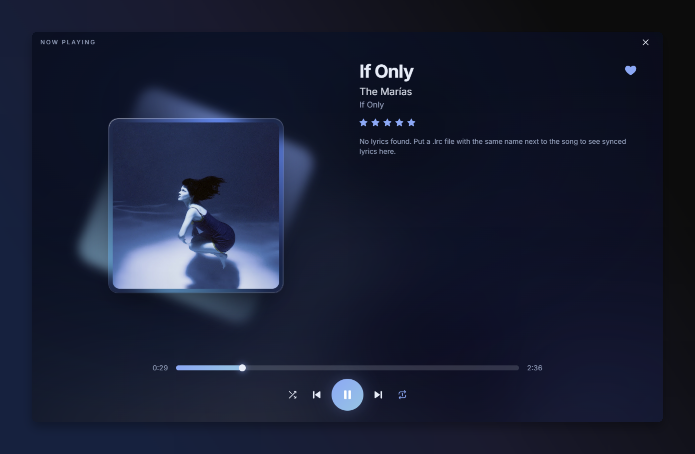
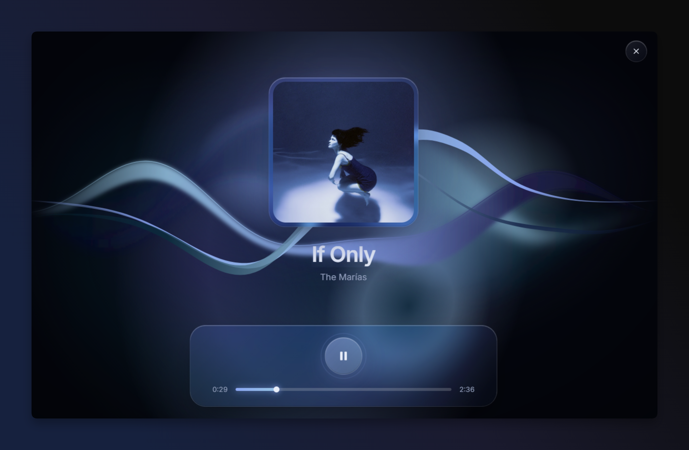
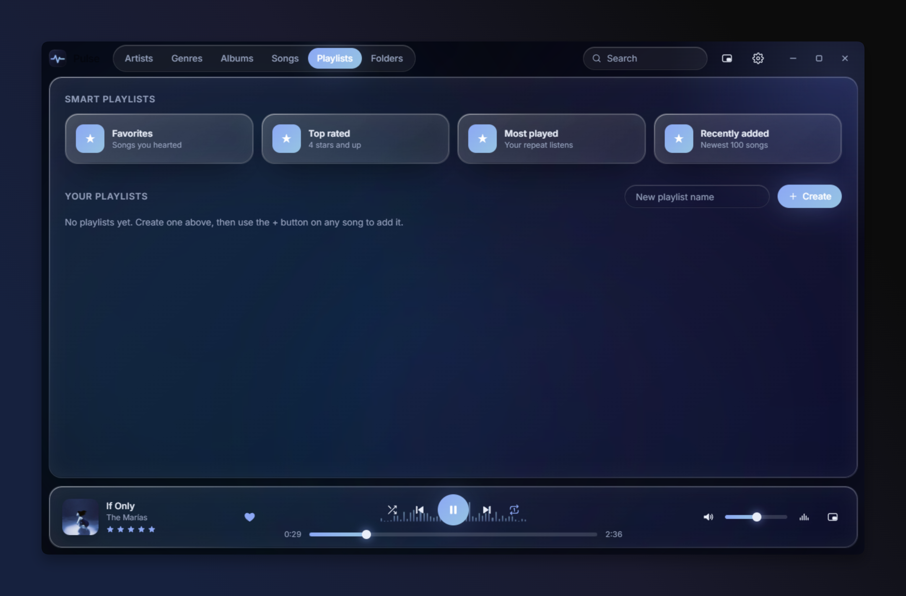
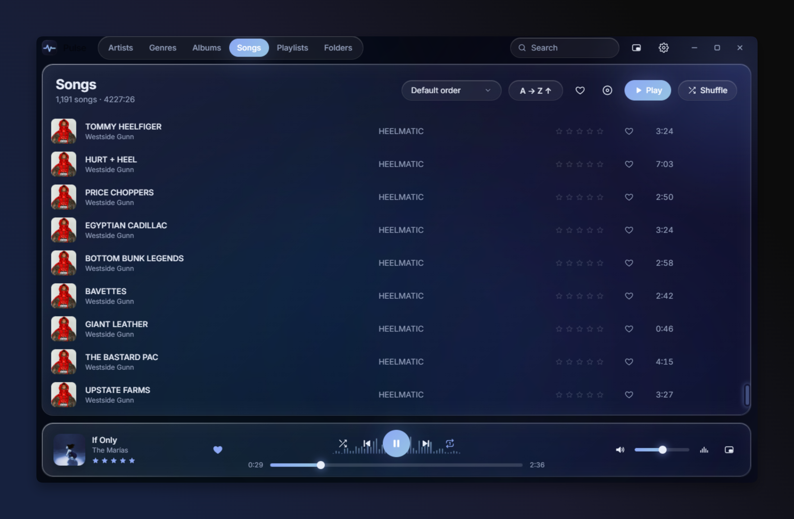
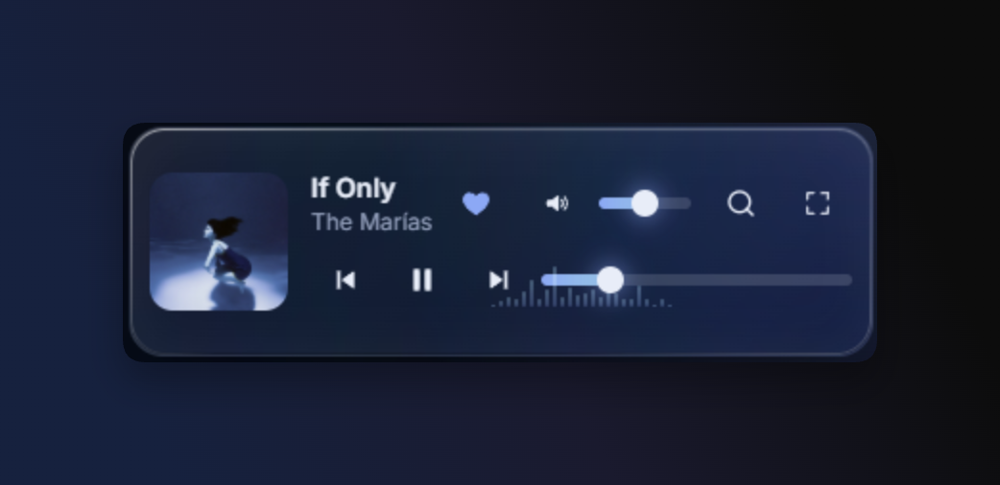
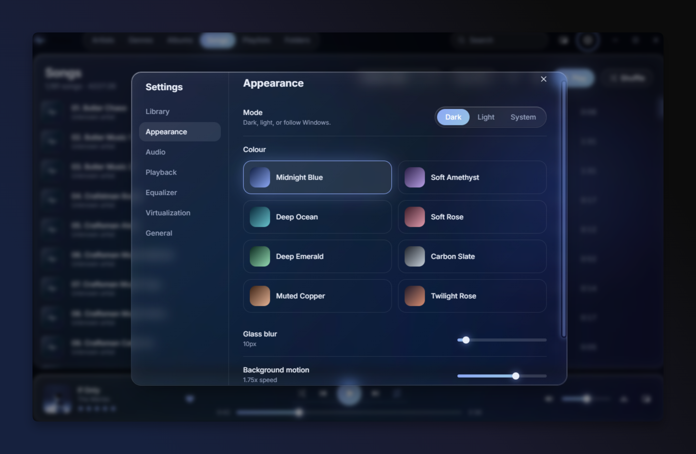
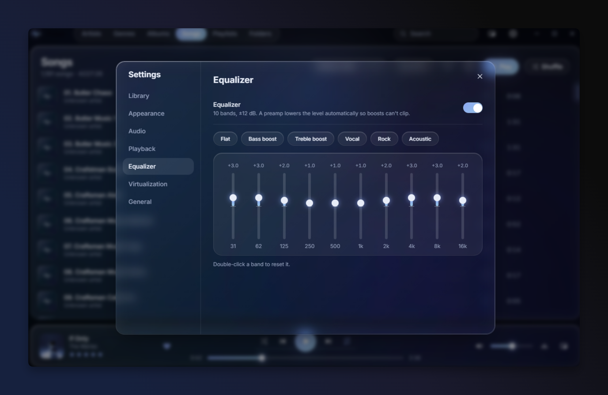
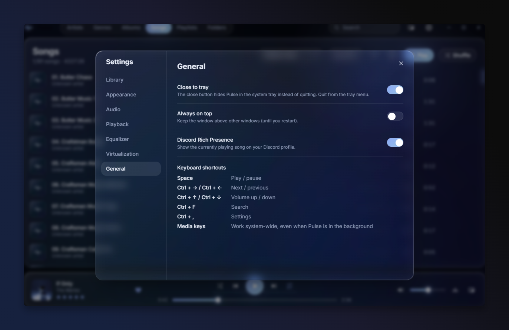

<p align="center">
  
</p>

<h1 align="center">Pulse</h1>

<p align="center">
  A premium, local-files music player for Windows. Built with a custom Rust audio engine and a stunning Liquid Glass UI.
</p>

<br />

<h2 align="center">✦ Screenshots</h2>

<table align="center" border="0">
  <tr>
    <td align="center">
      
    </td>
    <td align="center">
      
    </td>
  </tr>
  <tr>
    <td align="center">
      
    </td>
    <td align="center">
      
    </td>
  </tr>
  <tr>
    <td align="center">
      
    </td>
    <td align="center">
      
    </td>
  </tr>
  <tr>
    <td align="center">
      
    </td>
    <td align="center">
      
    </td>
  </tr>
</table>

<br />


# Pulse

A local-files music player built for Windows. Pulse was created to provide a fast, visually appealing listening experience without hogging system resources — no browser runtime, no Electron overhead, just a native Rust core and a lightweight React frontend.


---

## ★ Features

- **Custom Audio Engine** — Symphonia + CPAL, built from scratch with gapless playback and crossfade.
- **Headphone Virtualization** — AutoEQ simulation for popular headphones and IEMs.
- **Liquid Glass UI** — Frosted glass interface with 8 color themes and light/dark mode.
- **Real FFT Visualizer** — Frequency data computed live in Rust and streamed to the frontend.
- **Discord Rich Presence** — Live track, artist, album, progress timer, and playback state.
- **Pulse ZR** — Custom audio enhancement system with independent bass, treble, and stereo width knobs, plus built-in Surround and Booster toggles.
- **Crystallizer** — Restores high-frequency detail and transients with adjustable modes and intensity, rebuilt for clean, click-free processing.
- **ReplayGain** — Normalizes track volume to help prevent sudden loudness changes.
- **ReplayGain Analysis** — Scans your library and calculates ReplayGain tags based on the EBU R128 standard.
- **Online Section** — Stream music from SoundCloud without leaving the player, with built-in search, recent plays, and favorites.

---

## Table of Contents

- [Features](#-features)
- [Tech Stack](#tech-stack)
- [How to Install](#how-to-install)
- [Building from Source](#building-from-source)
- [Project Structure](#project-structure)
- [Credits and License](#credits-and-license)

---

## Tech Stack

**Backend**

| Component | Purpose |
| --- | --- |
| Rust | Core application logic |
| Tauri 2 | Application shell and IPC bridge |
| Rusqlite | Local library database and metadata cache |
| Symphonia | Audio decoding |
| CPAL | Audio output |
| Lofty | Tag and metadata reading |
| sabr-rs | SoundCloud stream handling |
| rustypipe-botguard | BotGuard support for online requests |


**Frontend**

| Component | Purpose |
| --- | --- |
| React 18 | UI layer |
| TypeScript | Type safety across the frontend |
| TailwindCSS | Styling and theming |
| Framer Motion | Animations and transitions |
| Zustand | State management |

---

## ↓ How to Install

Pulse ships as a standalone Windows executable. No installer or dependencies are required.

1. Go to the [Releases](../../releases) page.
2. Download the latest `.exe` file for Windows.
3. Place it in a folder of your choice and run it.
4. On first launch, point Pulse at a folder containing your music library.

### A note about the SmartScreen warning

This project does not have a commercial code-signing certificate. Windows SmartScreen flags unsigned executables by default, so you will likely see a message such as **"Windows protected your PC"** the first time you run Pulse.

This is expected. To proceed:

1. Click **More info** in the dialog.
2. Click **Run anyway**.

If you would prefer to verify the build yourself before running it, use the [Building from Source](#building-from-source) instructions below.

---

## Building from Source

### Prerequisites

- [Node.js](https://nodejs.org/) (LTS or newer) and npm
- [Rust](https://www.rust-lang.org/tools/install) with the stable toolchain
- **Microsoft C++ Build Tools** and the **WebView2** runtime (both required by Tauri on Windows)

### Commands

```bash
# Clone the repository
git clone https://github.com/arya8skrash/pulse-player.git

# Enter the project directory
cd pulse

# Install frontend dependencies
npm install

# Run in development mode with hot reload
npm run tauri dev

# Build a production release
npm run tauri build
```

The compiled executable and installers are written to `src-tauri/target/release/` after a successful build.

---

## Project Structure

```text
pulse/
├── src/                  # React frontend
│   ├── components/       # UI components
│   ├── store/            # Zustand state slices
│   └── lib/              # IPC bindings and utilities
├── src-tauri/            # Rust backend
│   ├── src/
│   │   ├── audio/        # Decoder, output, EQ, crossfade
│   │   ├── dsp/          # FFT and virtualization profiles
│   │   ├── db/           # Rusqlite schema and queries
│   │   └── scanner/      # Library indexing
│   └── Cargo.toml
└── package.json
```

---

## Credits and License

### AutoEQ

Headphone virtualization profiles are derived from the [AutoEQ](https://github.com/jaakkopasanen/AutoEQ) project by Jaakko Pasanen, which aggregates measurement data from sources including **oratory1990** and **crinacle**, and publishes parametric EQ compensation curves. AutoEQ is licensed under the MIT License. This project would not have a virtualization feature without that work.

---

## ⚖ License

This project is licensed under the GPL-3.0 License. See the [LICENSE](LICENSE) file for details.

Third-party dependencies remain under their respective licenses.
